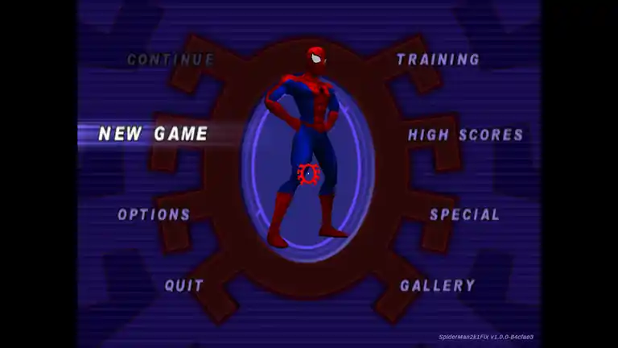
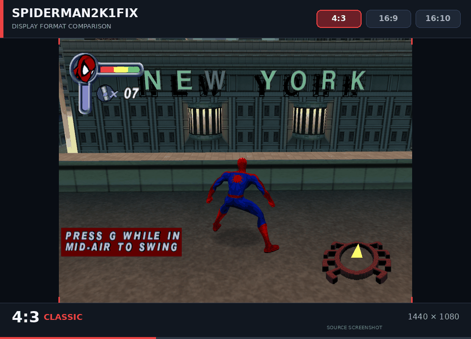

# SpiderMan2k1Fix

[](https://github.com/legluondunet/SpiderMan2k1Fix/actions/workflows/spiderman2k1fix-windows-x86.yml)
[](#installation-on-windows-and-linux-wine)

SpiderMan2k1Fix is an **unofficial fan-made patch** for the PC version of *Spider-Man*, released by Activision in 2001. It improves compatibility with modern Windows systems and Linux/Wine while adding new features.

## Screenshots

<table>
  <tr>
    <td width="50%" align="center">
      <a href="assets/screenshots/main-menu.webp">
        
      </a>
      <br>
      <sub><b>Main menu</b> — original 4:3 presentation</sub>
    </td>
    <td width="50%" align="center">
      <a href="assets/screenshots/aspect-ratio-comparison.gif">
        
      </a>
      <br>
      <sub><b>Aspect ratio comparison</b> — 4:3, 16:9 and 16:10</sub>
    </td>
  </tr>
</table>

## Main Features

- **No-CD:** Bypasses the original CD-ROM check through an in-memory patch, without modifying the game executable.
- **Modern display support:** Runs in borderless fullscreen at the monitor's native resolution, with automatic widescreen 3D (`Auto`) or a centered classic 4:3 mode. Also supports multi-monitor configurations.
- **Automatic FOV adjustment:** Automatically adjusts the field of view to match the desktop resolution and aspect ratio, providing proper widescreen rendering without distorting the 3D scene.
- **Aspect ratio corrections:** Preserves the original proportions of menus, cinematics, introductory videos, comic-book artwork, and other 2D elements.
- **Widescreen HUD:** Corrects the proportions and positioning of HUD elements, including health and web gauges, compass, mission objectives, boss health bars, and in-game pause menus. Tested at 1920×1080 (16:9) and 1920×1200 (16:10).
- **FPS limiter:** Configurable frame-rate cap, set to **30 FPS by default**. Lower limits, such as 20 FPS, can be selected for timing-sensitive gameplay.
- **Alt+Tab stability:** Automatically pauses the game when it loses focus, synchronizes video and audio playback, and restores keyboard and mouse input when gameplay resumes. Press any key after returning to the game to resume. Also restores the Windows desktop cursor when necessary.
- **Keyboard layouts:** Automatically detects the active keyboard layout and adapts the game's controls, keyboard labels, and cheat-code entry. The original game only supported QWERTY layouts.
- **DPI awareness:** Handles Windows display scaling to ensure correct window dimensions and rendering on high-DPI displays.
- **Settings preservation:** Keyboard, gamepad, audio, and brightness settings are managed through `SpiderMan2k1Fix.ini`, with automatic recovery of invalid settings and a single rolling `.ini.old` backup. The original `Spidey.cfg` file is no longer needed.
- **PNG screenshots:** Press **F9** to save lossless screenshots (`scrnNNNN.png`) in the game directory.
- **Debug logging:** Can generate a `SpiderMan2k1Fix.log` diagnostic file to help troubleshoot compatibility issues. Enable it by setting `Log=1` in the INI file.
- **Build identification:** Displays the patch version and source commit in the game's main menu and diagnostic logs.
- **Original taskbar icon:** Restores the game's original icon in the Windows taskbar.

Successfully tested on Windows 11 and Linux/Wine.

## Bugs Resolved

- **Alt+Tab crashes and input loss:** Fixed crashes and permanent loss of keyboard or mouse controls when switching between the game and other applications.
- **Focus-loss instability:** Added automatic game pausing with synchronized video and audio playback, preventing gameplay and media synchronization issues while the game is in the background.
- **Crash on exit:** Fixed a crash that could occur when quitting the game.
- **Broken F9 screenshots on Windows:** Fixed screenshots that appeared entirely purple or contained no visible game graphics.
- **Audio crackling:** Fixed truncated WAV loading by restoring missing final sectors through the game's native PKR reader while preserving DirectSound playback.
- **Unsupported display modes:** Prevented the game from switching to obsolete fullscreen resolutions and 16-bit display modes that could produce a black screen on modern monitors.
- **Hidden desktop cursor:** Fixed cases where the Windows mouse pointer remained invisible after switching away from the game.

## Known Issues in the Original Game

The following issues are inherited from the original game and remain unresolved:

- **FPS-dependent gameplay:** Certain bosses and levels may not work correctly at 30 FPS. Set `FPSLimit=20` in the INI file when needed.

## Known Issue in SpiderMan2k1Fix

- **Delayed pause under Wine:** The automatic pause triggered by loss of focus may occasionally activate with a delay. This issue remains unresolved.

## Built-in native WAV audio correction

The original game can truncate WAV resources by reading only complete
2,048-byte sectors from `data.pkr`. SpiderMan2k1Fix now **corrects this
automatically**, using the game's native PKR reader and independently
CRC-verified original WAV contents. Each missing remainder is verified
before writing only the exact bytes into the game's allocated buffer.
Even duplicate WAV sources must agree byte-for-byte; unsafe matches
are skipped. The original DirectSound playback engine is preserved.

**No audio-fix setting is required or written to the factory
`SpiderMan2k1Fix.ini`.** The correction is enabled automatically on
the supported, SHA-256-verified `SpideyPC.exe`. If troubleshooting
requires turning it off, advanced users may manually add
`ExperimentalAudioLoaderTail=0` to `[Debug]`. This is a hidden
compatibility override, not a default configuration setting.

The separate, optional `ExperimentalAudioHeli1Declick=1` still corrects
two known original samples in `Heli1.wav`. Optional read-only audio
diagnostics remain available through `ExperimentalPKRAudioIndex=1`
and `ExperimentalPKRAudioPlayTrace=1`.

The former late DirectSound-buffer repair
(`ExperimentalAudioPKRTailRestore`) has been removed. This built-in native
loader correction is introduced in **SpiderMan2k1Fix v1.1.0**. The
correction and duplicate-source repairs have been validated without
audible crackling under Linux/Wine; native Windows gameplay testing of
the new default-on configuration is still pending.

## Installation on Windows and Linux (Wine)

1. Install the original *Spider-Man (2001)* PC game.
2. Download the latest version of SpiderMan2k1Fix from the [GitHub Releases](https://github.com/legluondunet/SpiderMan2k1Fix/releases) page.
3. Extract `winmm.dll` and `SpiderMan2k1Fix.dll` into the game's installation directory, alongside `SpideyPC.exe`.
4. Launch the game normally under Windows.

   For Linux/Wine users, open a terminal in the game's installation directory and run:

   ```bash
   WINEDLLOVERRIDES="winmm=n,b" wine SpideyPC.exe
   ```

**Important:** The patch requires the original supported `SpideyPC.exe` executable (SHA-256):

```text
0a11a49f3f63d4bb15650f322d654553fc47234b01885b852a058ff074689dea
```

Other versions or modified copies of the executable are not supported.

**No original game files are included in this project.** You must provide your own legally obtained copy of the game.

## Configuration

The original game's menus allow players to configure keyboard controls, gamepad bindings, audio levels, and other game settings.

SpiderMan2k1Fix preserves these settings in a single configuration file, `SpiderMan2k1Fix.ini`, which is automatically created in the game's installation directory. This file replaces the original `Spidey.cfg`, which is no longer used.

The INI file also provides additional settings specific to SpiderMan2k1Fix:

### Main Settings

| Setting | Description |
|---|---|
| `AspectRatio=Auto` | Automatically adapts 3D gameplay to the monitor's aspect ratio. |
| `AspectRatio=4:3` | Uses the original 4:3 aspect ratio with centered pillarboxing. |
| `FPSLimit=30` | Limits gameplay to 30 FPS by default. Set to `20` for timing-sensitive sections or `0` to disable the limiter. |
| `KeyboardLayout=Auto / Off` | `Auto` automatically detects and uses the active keyboard layout. `Off` disables automatic detection and preserves the original QWERTY mapping. |
| `Log=1` | Enables diagnostic logging to `SpiderMan2k1Fix.log`. |

**Important:**

- Close the game before manually editing the INI file.
- Keep your existing INI file when updating the patch.
- The `[Internal] RawHex` value preserves original game settings and should not be modified manually.

For advanced settings and detailed explanations, see the [Configuration and Troubleshooting Guide](docs/references/CONFIGURATION.md).

## Building from Source

SpiderMan2k1Fix builds two 32-bit Windows DLLs (`SpiderMan2k1Fix.dll` and `winmm.dll`) using an MSVCRT-compatible MinGW-w64 toolchain.

### Linux

Install a 32-bit MSVCRT-targeting MinGW-w64 toolchain and run the following command from the project's root directory:

```bash
./build.sh
```

### Windows (MSYS2)

To build natively on Windows, use the [MSYS2](https://www.msys2.org/) **MINGW32** environment, which provides a 32-bit GCC toolchain targeting MSVCRT.

1. Install MSYS2 and launch the **MSYS2 MINGW32** shell.
2. Install the required tools:

   ```bash
   pacman -S --needed mingw-w64-i686-gcc git python
   ```

3. Open the SpiderMan2k1Fix source directory in the MINGW32 shell and run:

   ```bash
   CC=gcc bash ./build.sh
   ```

**Important:** Use the MINGW32 environment, not UCRT64 or CLANG64, because the patch requires a 32-bit MSVCRT-compatible build.

The Windows/MSYS2 build procedure has not yet been independently validated. The project's automated Windows DLL builds currently run on Ubuntu using a cross-compiler.

Successful builds produce both DLLs in the project's root directory.

Automated builds and tests are available through [GitHub Actions](https://github.com/legluondunet/SpiderMan2k1Fix/actions).

Bug reports and contributions are welcome through [GitHub Issues](https://github.com/legluondunet/SpiderMan2k1Fix/issues).

## Troubleshooting

**The patch does not load**

Make sure both DLL files are located alongside the supported `SpideyPC.exe`. Under Linux/Wine, verify that the `winmm=n,b` DLL override is active.

**The game behaves unexpectedly**

Enable diagnostic logging by setting `Log=1` under `[Debug]` in `SpiderMan2k1Fix.ini`, then try to reproduce the issue.

If the problem persists, report it through [GitHub Issues](https://github.com/legluondunet/SpiderMan2k1Fix/issues) and attach the generated `SpiderMan2k1Fix.log` file.

## Ideas for Future Versions

The following are possible improvements under consideration, subject to technical feasibility. **None are guaranteed to be implemented.**

- **Widescreen:** Correct 3D elements that appear misaligned near the edges of the screen.
- **Performance:** Explore 60 FPS support and fixes for FPS-dependent boss and level issues.
- **Quick saves:** Investigate instant game saving.
- **Audio:** Investigate any remaining sound anomalies not addressed by the built-in native WAV-sector repair.
- **Subtitles:** Explore subtitle support for pre-rendered movies, in-game cinematics, and gameplay dialogue.
- **Cheats:** Add optional INI settings for costumes, God Mode, What If? mode, and other cheats.
- **Additional content:** Explore support for *Spider-Man 2: Enter Electro*.
- **Graphics and modding:** Improve sprites, explore HD enhancements, and investigate mod support.
- **Achievements:** Explore an achievement system.
- **Other game version bonus:** Add bonus from other game versions non present in PC version, like Fantastic Four torch...
- **Shaders:** Add CRT shaders.
- **Rendering engine:** Explore support for Vulkan or DirectX 9 and later.

## Documentation

Additional technical information is available for users and developers:

- [Project Documentation](docs/README.md)
- [Configuration and Troubleshooting](docs/references/CONFIGURATION.md)
- [Development and Reverse Engineering](docs/DEVELOPMENT.md)
- [Automatic Keyboard Layout Detection](docs/references/KEYBOARD_LAYOUT_TECHNICAL.md)
- [F9 PNG Screenshot Capture](docs/references/F9_PNG_CAPTURE.md)
- [Changelog](CHANGELOG.md)

## Credits

Developed by **legluondunet assisted by ChatGPT (OpenAI)**.

Special thanks to [Krystalgamer](https://krystalgamer.github.io/index.html), whose reverse-engineering work on the original PC game contributed to the development of this patch.

## License and Disclaimer

SpiderMan2k1Fix is distributed under the [GNU General Public License v3.0](LICENSE) (**GPL-3.0-only**).

This license applies only to SpiderMan2k1Fix and does not cover the original game's executable, graphics, audio, or other proprietary assets.

This is an independent fan-made project and is not affiliated with, sponsored by, or endorsed by Activision, Neversoft, Gray Matter Interactive, or any other original developer, publisher, distributor, or rights holder.

*Spider-Man* and all associated trademarks and game content remain the property of their respective owners.
