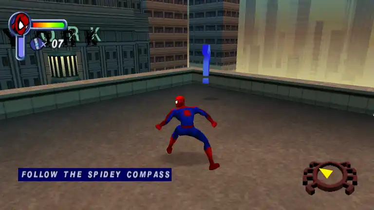

# SpiderMan2k1Fix

**A display and compatibility patch for the original *Spider-Man* (2001) Windows PC game.**

[](https://github.com/legluondunet/SpiderMan2k1Fix/actions/workflows/spiderman2k1fix-windows-x86.yml)
[](#installing-on-linux-with-wine)

### Screenshots

<p align="center">
  <a href="assets/screenshots/main-menu.webp"></a>
  <a href="assets/screenshots/gameplay.webp"></a>
</p>

SpiderMan2k1Fix is an **unofficial fan-made patch** that improves how the original game runs on modern Windows PCs and under Linux with Wine/Proton.

> **Development status:** This project is still being tested. **No stable release is available.** GitHub Actions provides experimental Windows x86 builds, but a successful build does not guarantee that the game works correctly on your system.

**Original game required:** **No files from the original game are included.** You must provide your **own legally obtained copy** of *Spider-Man* for Windows, including its original game data and `SpideyPC.exe`.

[Download and install](#download-and-install) · [Configuration](#configuration) · [Troubleshooting](#troubleshooting) · [Technical documentation](docs/README.md)

## What does the patch do?

- **Modern display modes:** borderless fullscreen at the desktop resolution, widescreen 3D or classic 4:3 presentation, and automatic aspect/FOV adjustments.
- **Original-looking 2D content:** introductory videos, comic artwork and menus retain their intended proportions. The HUD, compass and mission instructions are adapted for supported widescreen resolutions.
- **Game compatibility:** memory-only CD-check bypass for the supported executable and a default **30 FPS** limiter to avoid timing problems.
- **Settings and input:** configurable display, sound, keyboard and gamepad controls, with new AZERTY/QWERTY-aware INI key bindings. The original in-game key-name labels are not yet localized; focus/Alt+Tab recovery remains experimental.
- **Screenshots:** **F9** saves lossless PNG files (`scrnNNNN.png`) beside the game executable. The capture path still needs broader Windows/Wine runtime testing.

These features are under active development; some resolutions, gameplay scenes and combinations of settings have not been validated. For technical details and known limitations, see the [project documentation](docs/README.md).

## Download and install

### Before you begin

You need the original **32-bit Windows PC game** and its unmodified `SpideyPC.exe`. This is the **only executable currently supported** (SHA-256):

```text
0a11a49f3f63d4bb15650f322d654553fc47234b01885b852a058ff074689dea
```

Other executable versions and modified files are not validated. The patch consists of **two Windows x86 DLLs**, used on Windows or through a 32-bit-capable Wine/Proton installation on Linux.

**Get the test build:** Open [SpiderMan2k1Fix Windows x86 — GitHub Actions](https://github.com/legluondunet/SpiderMan2k1Fix/actions/workflows/spiderman2k1fix-windows-x86.yml), choose a successful run, and download **`SpiderMan2k1Fix-Windows-x86`** from **Artifacts**. Extract the downloaded archive. The automatically generated GitHub *source code* archives do not contain compiled DLLs.

### Installing on Windows

1. Locate the game's `SpideyPC.exe` folder. Back up any existing `winmm.dll`, `SpiderMan2k1Fix.dll` or `SpiderMan2k1Fix.ini`.
2. Copy **`winmm.dll`** and **`SpiderMan2k1Fix.dll`** from the downloaded artifact beside `SpideyPC.exe`:

   ```text
   Spider-Man/
   ├── SpideyPC.exe
   ├── winmm.dll
   └── SpiderMan2k1Fix.dll
   ```

3. Launch `SpideyPC.exe`. The patch automatically creates `SpiderMan2k1Fix.ini` on the first supported launch.

**Important:** If another mod already provides `winmm.dll`, do not overwrite it without a backup. See [upgrading from an older beta](docs/references/CONFIGURATION.md#upgrading-from-older-builds) if you previously used `SpiderManFix.dll`.

### Installing on Linux with Wine

Use **the same Windows x86 DLLs and game files** as above, then tell Wine to load the local `winmm.dll` before its built-in version.

From the game folder:

```bash
WINEDLLOVERRIDES="winmm=n,b" wine SpideyPC.exe
```

Alternatively, in **winecfg → Libraries**, set `winmm` to **Native then Builtin**. In **Lutris**, add a DLL override named `winmm` with value `n,b`. For a custom prefix, set `WINEPREFIX` in your launch environment.

**Steam / Proton:** Put the two DLLs beside `SpideyPC.exe`, then enter this in the game's **Steam → Properties → Launch Options**:

```text
WINEDLLOVERRIDES="winmm=n,b" %command%
```

The Linux / Wine / Proton badge is **informational, not the result of a Linux/Proton gameplay CI test**. Compatibility can vary with the Wine/Proton version, runner and graphics setup.

## Configuration

There is **no separate launcher**. Run `SpideyPC.exe` normally; the patch creates `SpiderMan2k1Fix.ini` next to it. **Close the game before editing the INI**, and keep that file when replacing the DLLs with a newer build.

A few common settings:

```ini
[Display]
Resolution=Auto
AspectRatio=Auto
FPSLimit=30

[HUD]
HUDWidescreenFix=1
```

- `AspectRatio=Auto`: adapt to the desktop aspect ratio; `AspectRatio=4:3`: classic 4:3 display.
- `FPSLimit=30`: default frame-rate limit.
- `HUDWidescreenFix=1`: apply supported HUD/menu aspect corrections; set `0` to disable them.

**AZERTY keyboard:** If physical keys appear swapped (A/Q, Z/W) or M is labeled as `;`, add `KeyboardLayout=AZERTY` under `[Input]` in the INI and restart. New INIs use `Auto` detection; this setting fixes action bindings, **not yet the labels in the original game's menus**. [Keyboard layout details](docs/references/CONFIGURATION.md#keyboard-layout-azerty-qwerty-and-wine).

For audio, controls, Alt+Tab options, INI repair and other settings, see the **[configuration guide](docs/references/CONFIGURATION.md)**.

## Troubleshooting

- **The patch does not load:** check that both DLLs are next to the supported `SpideyPC.exe`. On Wine/Proton, verify the `winmm=n,b` override.
- **Controls stop responding after Alt+Tab, or audio/graphics look wrong:** these areas are still being investigated. See [troubleshooting and experimental input options](docs/references/CONFIGURATION.md#troubleshooting-cases).
- **Your settings changed unexpectedly:** check for an automatic `SpiderMan2k1Fix_N.old` backup. [INI recovery details](docs/references/CONFIGURATION.md#automatic-ini-recovery).
- **Need a log?** Set `Log=1` under `[Debug]` in the INI and restart the game. The file `SpiderMan2k1Fix.log` is **overwritten at each launch**, so save it before restarting. Turn logging off afterward.

For more help, read the [full documentation](docs/README.md), [F9 capture notes](docs/references/F9_PNG_CAPTURE.md) and [widescreen/HUD research](docs/DEVELOPMENT.md#7-display-and-rendering-research).

## For developers

The source builds **Windows x86 DLLs**, even on Linux:

```bash
./build.sh
```

Building requires a 32-bit **MSVCRT-targeting MinGW-w64** toolchain; alternate tooling and automated tests are documented in [ChatGPT/](ChatGPT/README.md). Bug reports and reproducible results are welcome in [GitHub Issues](https://github.com/legluondunet/SpiderMan2k1Fix/issues); please include the OS/Wine version, game EXE checksum and relevant logs. The project is maintained by [legluondunet](https://github.com/legluondunet).

## Credits and acknowledgements

Special thanks to **[Krystalgamer](https://github.com/krystalgamer)** for sharing their [partial PC decompilation](https://github.com/krystalgamer/spidey-decomp) and [research into the original game's CD check](https://krystalgamer.github.io/spidey-breaking/index.html). These are valuable references for understanding the original game.

## License and third-party rights

The SpiderMan2k1Fix source code is licensed under the **[GNU General Public License, version 3](LICENSE)** (**GPL-3.0-only**). This license covers this patch, **not** the original game's executable, images, audio or other proprietary content.

This is an independent fan project, **not affiliated with, sponsored by, or endorsed by Activision**, Neversoft, LTI Gray Matter / Gray Matter Interactive, or any other original developer, publisher, distributor or rights holder. *Spider-Man* and its associated trademarks and game content remain the property of their respective owners.
